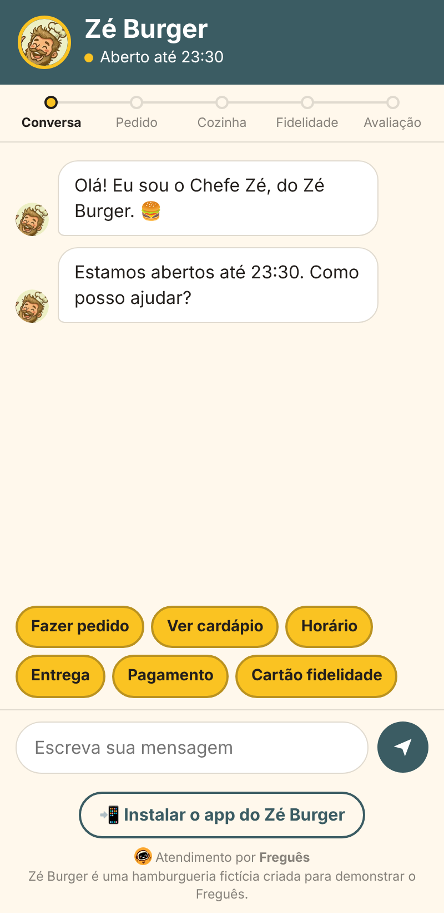
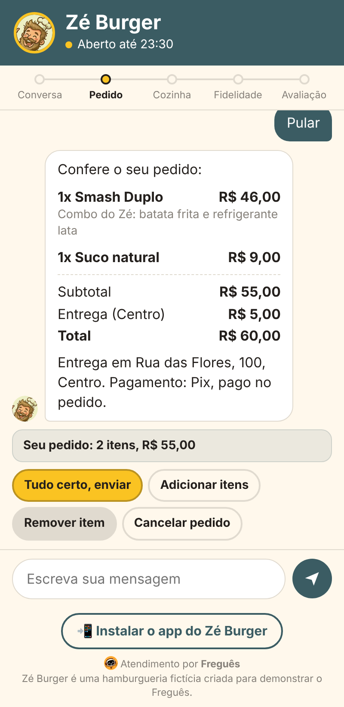
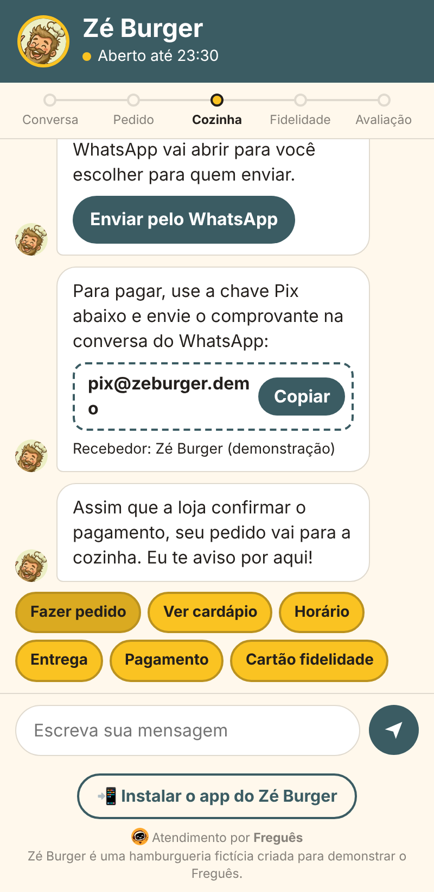
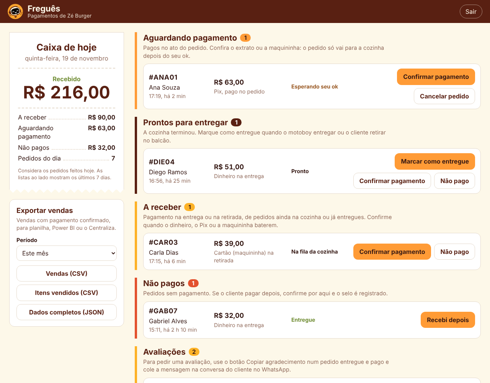
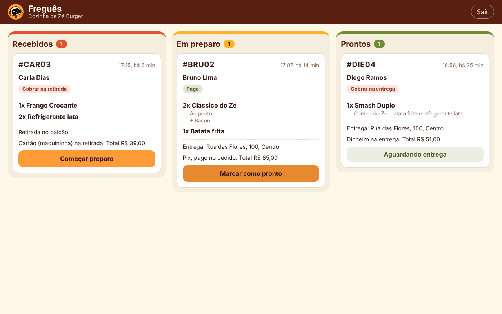
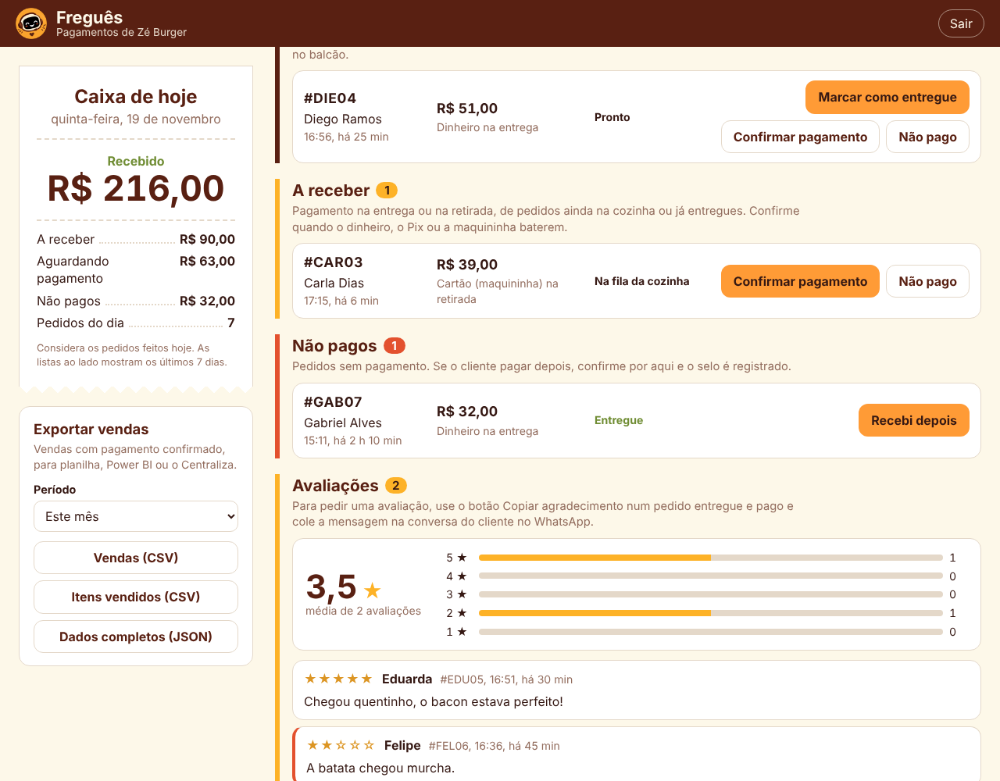

<p align="center">
  
</p>

# Freguês

**Do primeiro pedido ao freguês de sempre.**

Atendimento, pedidos e fidelidade para pequenos negócios de alimentação, com custo zero.

<p>
  <a href="https://katiadutra.github.io/fregues/"><strong>Fazer um pedido no Zé Burger</strong></a>,
  a lanchonete de demonstração. Para conhecer a gestão integrada, acesse o
  <a href="https://katiadutra.github.io/centraliza/"><strong>Centraliza</strong></a>.
</p>

> Trabalho final da residência Bolsa Futuro Digital.

---

## O problema

Muitas hamburguerias, lanchonetes e açaiterias de pequeno porte recebem pedidos pelo WhatsApp de forma manual. Isso gera mensagens soltas, adicionais esquecidos, erros de preço e nenhum controle sobre quem é cliente fiel. Ferramentas prontas costumam ter mensalidade, e a API oficial do WhatsApp tem custo e exige estrutura técnica que um MEI não tem.

## A solução

O Freguês é um assistente de atendimento que acompanha toda a jornada do cliente:

1. **Acolhe** o cliente, informa horário, cardápio e responde dúvidas.
2. **Monta o pedido** com o cliente, calculando o preço em tempo real.
3. **Envia o pedido** organizado para o WhatsApp da loja e para o painel da cozinha.
4. **Controla o pagamento**: o cliente paga no pedido ou no recebimento, e o administrador confirma cada pagamento.
5. **Registra selos** no cartão fidelidade, somente depois do pagamento confirmado.
6. **Faz o pós-venda**, pedindo uma avaliação e convidando o cliente a voltar.
7. **Organiza as vendas** num formato padrão, pronto para planilha, Power BI e o sistema de gestão [Centraliza](https://github.com/KatiaDutra/centraliza).

O chat pode ser **instalado no celular como aplicativo**, com o nome e o ícone da loja, sem passar por loja de aplicativos.

Tudo funciona com ferramentas gratuitas e sem a API paga do WhatsApp.

## Capturas de tela

| Boas-vindas | Resumo do pedido | Pagamento por Pix |
|---|---|---|
|  |  |  |

**Painel de pagamentos do administrador:** caixa do dia, pedidos aguardando pagamento, prontos para entregar, a receber e não pagos.



| Painel da cozinha | Avaliações e exportação de vendas |
|---|---|
|  |  |

## Uso de IA

No Freguês, **a IA entende e o sistema decide**.

- A IA interpreta pedidos escritos em texto livre e responde dúvidas sobre o cardápio.
- Preços, totais, selos e regras da loja são sempre calculados pelo código, a partir do arquivo de configuração.
- A chave da IA fica em uma função intermediária, nunca no navegador ou no GitHub.
- Se a IA estiver indisponível, o atendimento continua normalmente pelos botões.

## Adaptável a qualquer pequeno negócio

O cardápio, os preços, os horários, as dúvidas frequentes e as regras da loja ficam em um único arquivo de configuração (`config/ze-burger.json`). Trocando esse arquivo, o Freguês passa a atender outro negócio, sem alterar o código.

O Freguês funciona como **white-label**: no chat, o cliente final vê as cores, o nome e o atendente da loja, e o aplicativo instalado tem o ícone da loja. Assim, cada lanchonete tem o próprio app, sem pagar comissão a plataformas de delivery. A marca do Freguês aparece só no rodapé e nas telas de gestão usadas pela equipe da loja (cozinha e pagamentos).

## Aplicativo instalável (PWA)

O Freguês é um **PWA** (Progressive Web App): o próprio site pode ser instalado no celular ou no computador, com ícone na tela inicial e abertura em tela cheia, sem Play Store ou App Store e sem custo.

| App | Para quem | Nome e ícone | Arquivo |
|---|---|---|---|
| Chat da loja | Cliente final | Da loja (Zé Burger, na demonstração) | `config/ze-burger.webmanifest` |
| Cozinha | Equipe, por exemplo num tablet | Do Freguês | `cozinha.webmanifest` |
| Pagamentos | Administrador | Do Freguês | `admin.webmanifest` |

- **Android e computador (Chrome ou Edge):** o chat mostra o botão **Instalar o app**, ou use o menu do navegador > *Instalar app*.
- **iPhone (Safari):** botão Compartilhar > *Adicionar à Tela de Início*.

O `sw.js` (service worker) guarda uma cópia das telas para abrirem rápido e até sem internet. Ele busca sempre a versão mais nova quando há conexão, então uma atualização publicada no GitHub chega aos apps instalados sem o cliente baixar nada. Pedidos, pagamentos e selos continuam passando pelo Firebase.

Para outra loja, basta criar o manifesto dela em `config/` com os ícones em `assets/lojas/` e apontar o campo `app.manifesto` da configuração para ele.

## Vendas e integração

Quando o administrador confirma um pagamento, o Freguês grava uma **venda** num formato padronizado, descrito em [`docs/contrato-de-dados.md`](docs/contrato-de-dados.md): data, cliente, forma de pagamento, entrega e os itens com produto, categoria, quantidade e preço. Pedido não pago não vira venda.

No painel do administrador, **Exportar vendas** gera, para o período escolhido:

- **Vendas (CSV):** uma linha por venda, para faturamento, ticket médio e formas de pagamento;
- **Itens vendidos (CSV):** uma linha por item, para produtos mais vendidos e curva ABC;
- **Dados completos (JSON):** o contrato de dados inteiro, para importar em outros sistemas.

Os CSV abrem direto no Excel e no Power BI, no padrão brasileiro.

## Integração com o Centraliza

O [Centraliza](https://github.com/KatiaDutra/centraliza) é a gestão do negócio. Os dois sistemas usam o **mesmo projeto do Firebase**, então compartilham o banco e o login, e o arquivo `firestore.rules` é igual nos dois repositórios.

- Um pedido marcado como **não pago** vira um atendimento do Financeiro no Centraliza, que se resolve sozinho se o pagamento for confirmado depois.
- Uma avaliação de **1 ou 2 estrelas** vira um atendimento do Suporte, com o comentário do cliente.
- Pela tela de entrada do Centraliza, a cozinha cai direto no painel da cozinha, e o administrador chega aos pagamentos pelo menu.

O próximo passo é o Centraliza ler as vendas, transformando cada venda em receita e cada item em baixa de estoque.

## Perfis de acesso

O Freguês tem três perfis, cada um com uma tela e permissões próprias:

| Perfil | Tela | O que faz |
|---|---|---|
| Cliente | `index.html` | Conversa com o bot, monta e envia o pedido, acompanha o status e consulta o cartão fidelidade. Não precisa de login. |
| Cozinha | `cozinha.html` | Vê os pedidos liberados e avança o preparo até "pronto". Sabe se o pedido já está pago ou se precisa cobrar na entrega, mas não mexe em pagamentos, entregas nem selos. |
| Administrador | `admin.html` | Confere e confirma os pagamentos, marca a entrega (motoboy ou balcão), marca pedidos não pagos, cancela pedidos sem pagamento, acompanha o caixa do dia e lê as avaliações. |

Separar quem produz de quem confere o dinheiro é um princípio básico de controle: impede que um pedido não pago gere selo de fidelidade. Uma mesma pessoa pode ter os dois papéis, o que é comum em negócios pequenos, e nesse caso navega entre as duas telas pelo topo.

### Como funciona o pagamento

Cada loja escolhe no arquivo de configuração quais formas aceita em cada momento:

| Momento | Formas na demonstração | Quando vai para a cozinha |
|---|---|---|
| No pedido | Pix (o chat mostra a chave) ou link de pagamento por cartão, enviado pela loja no WhatsApp | Só depois que o admin confere o extrato e confirma |
| Na entrega ou na retirada | Cartão na maquininha, Pix ou dinheiro | Na hora; o admin confirma depois de receber |

O selo de fidelidade é registrado **na mesma operação** em que o admin confirma o pagamento. Pedido marcado como não pago fica numa lista própria e não gera selo; se o cliente pagar depois, o admin confirma por lá. Uma confirmação não pode ser desfeita, porque o selo já foi registrado junto.

### Como funciona o pós-venda

A cozinha termina o trabalho dela no "pronto". Quem marca a entrega é o administrador, que lida com o motoboy e com o balcão. O cliente só avalia depois de receber o pedido e de o pagamento estar confirmado, e o pedido de avaliação chega **10 minutos depois da entrega**, para ele comer com calma (o tempo é definido por loja, em `posVenda.minutosAposEntrega`). Se o pagamento for confirmado depois desse prazo, a avaliação vem logo após a confirmação. Nesse momento, o bot pergunta ao cliente como foi, com notas de 1 a 5 e um comentário opcional. Se o cliente fechou o chat antes, o administrador copia uma mensagem de agradecimento pronta, com um link para avaliar, e cola na conversa do cliente no WhatsApp. O Freguês não guarda o telefone do cliente, então não envia mensagens sozinho: o dono cola e envia, mantendo a privacidade e o custo zero.

A confirmação do pagamento é manual de propósito: com custo zero, não há integração com banco ou maquininha. Num próximo passo, essa conferência pode ser automatizada com a API de um meio de pagamento.

## Roteiro de desenvolvimento

### Versão 1: atendimento e pedido
- [x] Acolhimento com horário de funcionamento e perguntas frequentes
- [x] Montagem do pedido com adicionais, combos e preço em tempo real
- [x] Entrega ou retirada, com taxa por bairro e pedido mínimo
- [x] Envio do pedido resumido para o WhatsApp da loja
- [ ] Pedido em texto livre e dúvidas respondidas com IA
- [x] Painel da cozinha com status do pedido em tempo real

### Versão 2: fidelidade
- [x] Cartão fidelidade identificado pelo telefone
- [x] Selo registrado automaticamente para o cliente
- [x] Resgate do prêmio

### Versão 3: perfis e pagamentos
- [x] Três perfis com permissões próprias: cliente, cozinha e administrador
- [x] Pagamento no pedido ou no recebimento, com as formas definidas por loja
- [x] Chave Pix com botão de copiar no chat
- [x] Painel do administrador com confirmação de pagamento, não pagos, cancelamento e caixa do dia
- [x] Pedido pago no ato só chega à cozinha depois da confirmação
- [x] Selo de fidelidade registrado somente com o pagamento confirmado

### Versão 4: pós-venda
- [x] Entrega marcada pelo administrador, para tele e retirada
- [x] Avaliação do pedido de 1 a 5, com comentário opcional, alguns minutos depois da entrega
- [x] Mensagem de agradecimento pronta para o dono copiar, com link para avaliar depois
- [x] Avaliações no painel do administrador: nota média, distribuição e comentários, com destaque para as notas baixas
- [ ] Resumo das avaliações com IA (bônus)

### Versão 5: aplicativo e vendas
- [x] Chat instalável no celular (PWA), com o nome e o ícone da loja
- [x] Painéis da cozinha e do administrador instaláveis, com a marca do Freguês
- [x] Funcionamento com internet instável, com as telas guardadas pelo service worker
- [x] Vendas confirmadas em formato padronizado, com contrato de dados documentado
- [x] Exportação das vendas e dos itens vendidos para planilha, Power BI e JSON

### Integração com o Centraliza
- [x] Mesmo projeto do Firebase e mesmo login: cada pessoa da equipe entra uma vez e chega à tela do seu papel
- [x] Pedidos não pagos e avaliações de 1 ou 2 estrelas viram atendimentos no [Centraliza](https://github.com/KatiaDutra/centraliza), e o não pago se resolve sozinho quando o pagamento é confirmado
- [ ] Vendas do Freguês como receitas e baixa de estoque na gestão do negócio

## Segurança dos dados

Os dados ficam no Firestore, protegidos pelas regras em `firestore.rules`. Os papéis da equipe ficam em documentos `equipe/{uid}`, criados à mão no console do Firebase, e o próprio site não consegue alterá-los.

- qualquer pessoa pode **criar** um pedido, desde que ele tenha o formato esperado, comece com o pagamento pendente e no status certo para o momento do pagamento;
- o cliente consulta **apenas o próprio pedido**, pelo código dele;
- a **cozinha** só avança o preparo, na ordem certa, até "pronto", e só de pedidos já liberados: um pedido esperando pagamento não pode ser preparado;
- só o **administrador** marca um pedido pronto como entregue, e a hora da entrega é registrada pelo servidor;
- o **administrador** é o único que muda a situação do pagamento, e um pagamento confirmado não pode ser desfeito;
- uma **venda** só pode ser gravada pelo administrador, junto com a confirmação do pagamento do mesmo pedido e com o mesmo total; vendas não podem ser alteradas nem apagadas, e só o administrador as lê;
- uma **avaliação** só pode ser feita para um pedido que existe, foi entregue e está pago, uma única vez, e não pode ser alterada nem apagada; só o administrador lista as avaliações;
- os **selos de fidelidade** só podem ser registrados pelo administrador, então nenhum selo nasce sem pagamento confirmado e nenhum cliente consegue dar selos a si mesmo;
- ninguém pode apagar pedidos, e a criação de novas contas está desativada no Authentication.

### Privacidade no cartão fidelidade

O telefone do cliente **não é salvo no banco**. O navegador gera um código SHA-256 a partir do telefone, e é esse código que identifica o cartão. O cartão guarda apenas o primeiro nome e as datas dos selos, sem endereço nem histórico de compras. O cliente pode pular essa etapa e fazer o pedido normalmente.

A configuração do Firebase em `js/firebase.js` é pública por natureza: ela identifica o projeto, mas não dá acesso aos dados. Quem protege os dados são as regras.

Se o Firebase estiver indisponível, o chat continua funcionando e o pedido segue normalmente pelo WhatsApp.

## Tecnologias

- HTML, CSS e JavaScript (sem frameworks)
- Firebase, no plano gratuito (Firestore e Authentication), compartilhado com o Centraliza
- Cloudflare Workers, no plano gratuito, para a função intermediária da IA
- Links `wa.me` do WhatsApp
- GitHub Pages

## Como rodar localmente

O projeto carrega o arquivo de configuração com `fetch`, então ele precisa ser aberto por um servidor local, e não clicando direto no `index.html`.

1. Clone o repositório:
   ```bash
   git clone https://github.com/KatiaDutra/fregues.git
   ```
2. Abra a pasta no VS Code.
3. Instale a extensão **Live Server**.
4. Clique com o botão direito no `index.html` e escolha **Open with Live Server**.

## Estrutura do projeto

```
fregues/
├── index.html            Página do cliente (chat)
├── cozinha.html          Painel da cozinha (login e pedidos em tempo real)
├── admin.html            Painel do administrador (pagamentos, entregas, avaliações e vendas)
├── sw.js                 Service worker: app instalável e telas sem internet
├── cozinha.webmanifest   App da cozinha
├── admin.webmanifest     App do administrador
├── firestore.rules       Regras de segurança do banco
├── css/
│   ├── estilos.css       Chat, com o tema da loja
│   ├── cozinha.css       Base dos painéis, com a identidade do Freguês
│   └── admin.css         Caixa do dia e filas de pagamento
├── js/
│   ├── main.js           Ponto de entrada
│   ├── app.js            Registro do app e botão de instalar
│   ├── config.js         Carrega a configuração da loja
│   ├── tema.js           Aplica as cores e fontes da loja
│   ├── horario.js        Calcula se a loja está aberta
│   ├── ui.js             Mensagens, opções e jornada na tela
│   ├── conversa.js       Perguntas, respostas e o bot "digitando"
│   ├── bot.js            Acolhimento, dúvidas e menu principal
│   ├── fluxo-pedido.js   Roteiro da montagem do pedido
│   ├── pedido.js         Regras e cálculo do pedido
│   ├── whatsapp.js       Resumo e link para o WhatsApp
│   ├── firebase.js       Conexão com o Firebase
│   ├── banco.js          Pedidos, pagamentos, vendas, equipe, selos e avaliações no Firestore
│   ├── acesso.js         Login da equipe e conferência dos papéis
│   ├── cozinha.js        Lógica do painel da cozinha
│   ├── admin.js          Lógica do painel do administrador
│   ├── fidelidade.js     Telefone protegido, selos e desenho do cartão
│   ├── avaliacao.js      Avaliação do pedido no chat e pelo link
│   ├── exportacao.js     Arquivos CSV e JSON das vendas
│   └── ia.js             Camada opcional de IA
├── config/
│   ├── ze-burger.json    Cardápio e regras da loja de demonstração
│   └── ze-burger.webmanifest  App da loja de demonstração
├── worker/               Função intermediária da IA
├── assets/img/           Logo, ícones e favicon do Freguês
├── assets/lojas/         Imagens de cada loja (avatar, ícones do app)
└── docs/
    ├── contrato-de-dados.md  Formato das vendas para outros sistemas
    ├── capturas/             Capturas de tela deste README
    └── validacao/            Registro dos testes com usuários
```

## Validação com usuários

O sistema será testado com donos de pequenos negócios de alimentação e com clientes finais. Os registros, sempre anônimos, ficarão em `docs/validacao/`.

## Identidade visual

<p align="center">
  
</p>

O mascote do Freguês é um atendente robô: o fone representa o atendimento, o avental com coração representa o acolhimento e o celular representa o pedido. Os cinco ícones ao lado do nome mostram a jornada do cliente no sistema: conversa, pedido, cozinha, fidelidade e pós-venda.

| Cor | Hex | Uso |
|---|---|---|
| Creme | `#FDF8E9` | Fundo |
| Marrom | `#592012` | Texto principal e marca |
| Laranja | `#FF9B36` | Destaques e botões |
| Amarelo | `#FDB227` | Selos e sublinhados |
| Vermelho | `#E3512E` | Conversa e alertas |
| Verde | `#708D34` | Cozinha e confirmações |

As imagens da marca foram geradas com IA (Google Gemini) a partir de direção criativa da autora e adaptadas para uso na web.

## Demonstração

O Zé Burger está em **modo demonstração** (`"demonstracao": true` na configuração): é possível fazer pedidos mesmo fora do horário de funcionamento, e o botão do WhatsApp abre o aplicativo com o pedido pronto para você escolher o contato. Em uma loja real, basta desligar essa opção e informar o número da loja.

**Zé Burger é uma hamburgueria fictícia criada para demonstrar o Freguês.** Qualquer semelhança com estabelecimentos reais é coincidência.

## Autora

Katia Dutra · [GitHub](https://github.com/KatiaDutra)
