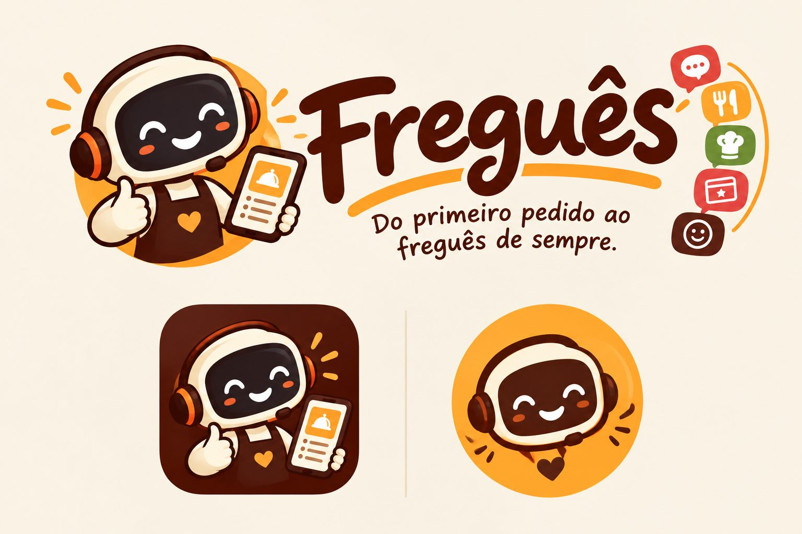

<p align="center">
  
</p>

# Freguês

**Do primeiro pedido ao freguês de sempre.**

Atendimento, pedidos e fidelidade para pequenos negócios de alimentação, com custo zero.

> Projeto em desenvolvimento como trabalho final da residência Bolsa Futuro Digital.

---

## O problema

Muitas hamburguerias, lanchonetes e açaiterias de pequeno porte recebem pedidos pelo WhatsApp de forma manual. Isso gera mensagens soltas, adicionais esquecidos, erros de preço e nenhum controle sobre quem é cliente fiel. Ferramentas prontas costumam ter mensalidade, e a API oficial do WhatsApp tem custo e exige estrutura técnica que um MEI não tem.

## A solução

O Freguês é um assistente de atendimento que acompanha toda a jornada do cliente:

1. **Acolhe** o cliente, informa horário, cardápio e responde dúvidas.
2. **Monta o pedido** com o cliente, calculando o preço em tempo real.
3. **Envia o pedido** organizado para o WhatsApp da loja e para o painel da cozinha.
4. **Registra selos** no cartão fidelidade do cliente.
5. **Faz o pós-venda**, pedindo uma avaliação e convidando o cliente a voltar.

Tudo funciona com ferramentas gratuitas e sem a API paga do WhatsApp.

## Uso de IA

No Freguês, **a IA entende e o sistema decide**.

- A IA interpreta pedidos escritos em texto livre e responde dúvidas sobre o cardápio.
- Preços, totais, selos e regras da loja são sempre calculados pelo código, a partir do arquivo de configuração.
- A chave da IA fica em uma função intermediária, nunca no navegador ou no GitHub.
- Se a IA estiver indisponível, o atendimento continua normalmente pelos botões.

## Adaptável a qualquer pequeno negócio

O cardápio, os preços, os horários, as dúvidas frequentes e as regras da loja ficam em um único arquivo de configuração (`config/ze-burger.json`). Trocando esse arquivo, o Freguês passa a atender outro negócio, sem alterar o código.

O Freguês funciona como **white-label**: no chat, o cliente final vê as cores, o nome e o atendente da loja. A marca do Freguês aparece só no rodapé e, futuramente, nas telas de gestão usadas pelo dono do negócio.

## Roteiro de desenvolvimento

### Versão 1: atendimento e pedido
- [x] Acolhimento com horário de funcionamento e perguntas frequentes
- [x] Montagem do pedido com adicionais, combos e preço em tempo real
- [x] Entrega ou retirada, com taxa por bairro e pedido mínimo
- [x] Envio do pedido resumido para o WhatsApp da loja
- [ ] Pedido em texto livre e dúvidas respondidas com IA
- [x] Painel da cozinha com status do pedido em tempo real

### Versão 2: fidelidade
- [ ] Cartão fidelidade identificado pelo telefone
- [ ] Selo automático quando o pedido é concluído
- [ ] Resgate do prêmio

### Versão 3: pós-venda
- [ ] Avaliação do pedido de 1 a 5
- [ ] Mensagem de agradecimento pronta para o dono enviar
- [ ] Resumo das avaliações com IA

## Segurança dos dados

Os pedidos ficam no Firestore, protegidos pelas regras em `firestore.rules`:

- qualquer pessoa pode **criar** um pedido, desde que ele tenha o formato esperado e comece com o status "recebido";
- o cliente consulta **apenas o próprio pedido**, pelo código dele;
- só o usuário da cozinha, identificado pelo UID, pode **listar** os pedidos e **mudar o status**;
- ninguém pode apagar pedidos, e a criação de novas contas está desativada no Authentication.

A configuração do Firebase em `js/firebase.js` é pública por natureza: ela identifica o projeto, mas não dá acesso aos dados. Quem protege os dados são as regras.

Se o Firebase estiver indisponível, o chat continua funcionando e o pedido segue normalmente pelo WhatsApp.

## Tecnologias

- HTML, CSS e JavaScript (sem frameworks)
- Firebase, no plano gratuito (Firestore e Authentication)
- Cloudflare Workers, no plano gratuito, para a função intermediária da IA
- Links `wa.me` do WhatsApp
- GitHub Pages

## Como rodar localmente

O projeto carrega o arquivo de configuração com `fetch`, então ele precisa ser aberto por um servidor local, e não clicando direto no `index.html`.

1. Clone o repositório:
   ```bash
   git clone https://github.com/KatiaDutra/fregues.git
   ```
2. Abra a pasta no VS Code.
3. Instale a extensão **Live Server**.
4. Clique com o botão direito no `index.html` e escolha **Open with Live Server**.

## Estrutura do projeto

```
fregues/
├── index.html            Página do cliente (chat)
├── cozinha.html          Painel da cozinha (login e pedidos em tempo real)
├── firestore.rules       Regras de segurança do banco
├── css/
│   ├── estilos.css       Chat, com o tema da loja
│   └── cozinha.css       Painel, com a identidade do Freguês
├── js/
│   ├── main.js           Ponto de entrada
│   ├── config.js         Carrega a configuração da loja
│   ├── tema.js           Aplica as cores e fontes da loja
│   ├── horario.js        Calcula se a loja está aberta
│   ├── ui.js             Mensagens, opções e jornada na tela
│   ├── conversa.js       Perguntas, respostas e o bot "digitando"
│   ├── bot.js            Acolhimento, dúvidas e menu principal
│   ├── fluxo-pedido.js   Roteiro da montagem do pedido
│   ├── pedido.js         Regras e cálculo do pedido
│   ├── whatsapp.js       Resumo e link para o WhatsApp
│   ├── firebase.js       Conexão com o Firebase
│   ├── banco.js          Gravação e leitura dos pedidos
│   ├── cozinha.js        Lógica do painel da cozinha
│   └── ia.js             Camada opcional de IA
├── config/
│   └── ze-burger.json    Cardápio e regras da loja de demonstração
├── worker/               Função intermediária da IA
├── assets/img/           Logo, ícones e favicon do Freguês
├── assets/lojas/         Imagens de cada loja (avatar, logo)
└── docs/validacao/       Registro dos testes com usuários
```

## Validação com usuários

O sistema será testado com donos de pequenos negócios de alimentação e com clientes finais. Os registros, sempre anônimos, ficarão em `docs/validacao/`.

## Identidade visual

<p align="center">
  
</p>

O mascote do Freguês é um atendente robô: o fone representa o atendimento, o avental com coração representa o acolhimento e o celular representa o pedido. Os cinco ícones ao lado do nome mostram a jornada do cliente no sistema: conversa, pedido, cozinha, fidelidade e pós-venda.

| Cor | Hex | Uso |
|---|---|---|
| Creme | `#FDF8E9` | Fundo |
| Marrom | `#592012` | Texto principal e marca |
| Laranja | `#FF9B36` | Destaques e botões |
| Amarelo | `#FDB227` | Selos e sublinhados |
| Vermelho | `#E3512E` | Conversa e alertas |
| Verde | `#708D34` | Cozinha e confirmações |

As imagens da marca foram geradas com IA (Google Gemini) a partir de direção criativa da autora e adaptadas para uso na web.

## Demonstração

O Zé Burger está em **modo demonstração** (`"demonstracao": true` na configuração): é possível fazer pedidos mesmo fora do horário de funcionamento, e o botão do WhatsApp abre o aplicativo com o pedido pronto para você escolher o contato. Em uma loja real, basta desligar essa opção e informar o número da loja.

**Zé Burger é uma hamburgueria fictícia criada para demonstrar o Freguês.** Qualquer semelhança com estabelecimentos reais é coincidência.

## Autora

Katia Dutra · [GitHub](https://github.com/KatiaDutra)
